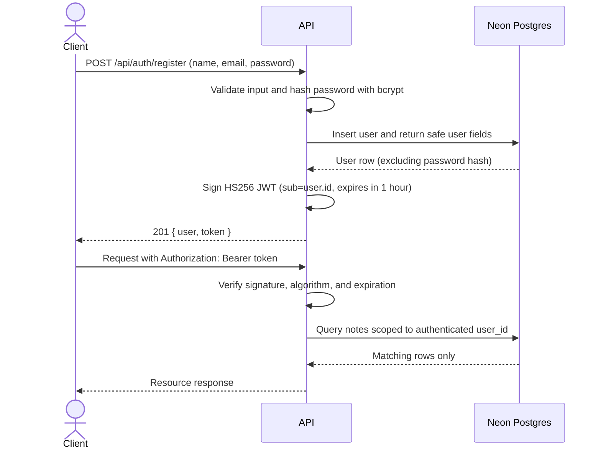

# Notes API

A REST API built with Node.js 20, Express 5 (ES modules), and Neon Postgres.

## Setup

1. Install Node.js 20 or newer and run `npm install`.
2. Create a Neon project. Create one branch for development and a separate branch for tests. Neon branches are isolated database environments that can be created from a parent branch; schema/data can be inherited at the time the branch is created, and later changes are isolated.
3. Copy `.env.example` to `.env`. Set `DATABASE_URL` to the development branch connection string and `TEST_DATABASE_URL` to the separate test branch connection string. Never point `TEST_DATABASE_URL` at production or the development branch.
4. Generate a JWT secret, for example with `node -e "console.log(require('node:crypto').randomBytes(32).toString('base64url'))"`, and set `JWT_SECRET` in `.env`. It must be at least 32 characters.
5. Apply [`db/schema.sql`](./db/schema.sql) to both Neon branches using the Neon SQL Editor.
6. Run `npm run dev`; the API listens on port 4000 by default.
7. Run `npm test` to execute the database-backed tests. The test suite requires `TEST_DATABASE_URL`, refuses to use the same URL as `DATABASE_URL`, and points the API at the test URL before importing it. It creates uniquely named users and removes them after the tests.

Use the REST Client extension in VS Code to run requests from [`requests.http`](./requests.http). The register and login examples use fixed sample emails; change them if those addresses already exist in your development database.

To create a valid expired token for the expired-token request in `requests.http`, run:

```powershell
node --env-file=.env --input-type=module -e "import jwt from 'jsonwebtoken'; console.log(jwt.sign({ sub: '00000000-0000-4000-8000-000000000001', exp: Math.floor(Date.now() / 1000) - 1 }, process.env.JWT_SECRET, { algorithm: 'HS256' }))"
```

Paste the printed token into `@expiredToken` in `requests.http`. Keep it local; it is signed with your application secret.

## Endpoints

| Method | Path | Authentication | Purpose |
| --- | --- | --- | --- |
| `GET` | `/api/health` | No | Check API and database health |
| `POST` | `/api/auth/register` | No | Create an account and return a user and JWT |
| `POST` | `/api/auth/login` | No | Authenticate and return a user and JWT |
| `GET` | `/api/auth/me` | Bearer token | Return the current user |
| `GET` | `/api/notes` | Bearer token | List the current user's notes; supports `q`, `tag`, `pinned`, `page` (default 1), and `limit` (default 20, max 100). Returns `{ notes, pagination: { page, limit, total, totalPages } }`. |
| `GET` | `/api/notes/:id` | Bearer token | Get one of the current user's notes |
| `POST` | `/api/notes` | Bearer token | Create a note |
| `PATCH` | `/api/notes/:id` | Bearer token | Update provided note fields |
| `DELETE` | `/api/notes/:id` | Bearer token | Delete a note |

Validation errors return `422`, missing or invalid authentication returns `401`, and inaccessible or nonexistent notes return `404`.

## Authentication flow



## Security

- Passwords are hashed with bcryptjs at cost 12 and are never included in user responses.
- JWTs are signed with HS256, expire after one hour, and are verified with HS256 explicitly allowed.
- Authentication routes are rate-limited to 10 requests per IP per 15 minutes.
- Zod validates request bodies, query parameters, and note UUIDs.
- Database calls use parameterized Neon tagged-template SQL; dynamic list filters compose SQL fragments rather than concatenating input into SQL text.
- Every note lookup, update, and deletion is scoped by the authenticated `user_id`; inserts use that user ID. Foreign-user notes return the same `404` as nonexistent notes to avoid disclosing their existence.
- Helmet, a restricted CORS allowlist, and a 100 KB JSON body limit are enabled.
- Production error responses do not include stack traces or SQL details.

## Tests and Neon branches

The test suite uses real Neon Postgres integration through `TEST_DATABASE_URL`. Create a dedicated test branch in the Neon console, use its connection string only for `TEST_DATABASE_URL`, and apply the schema to that branch. Neon branching gives tests an isolated database environment; test-created users are cleaned up, but a separate branch still prevents test setup or cleanup from touching development or production data.
